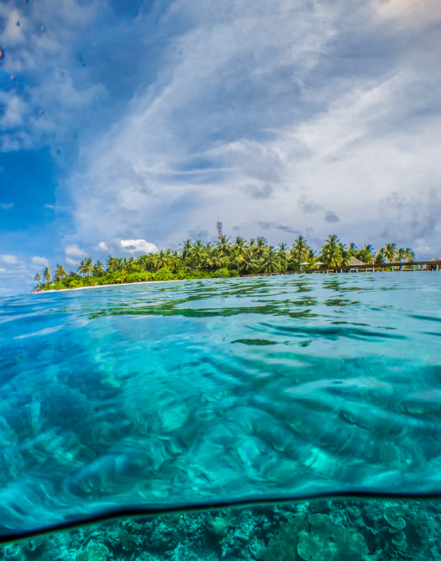

# 편집# 신규 대작 인계서 — 바다에서 지구 반대편까지

작성일: 2026-11-02 (한국시간)

## 1. 인계 목적과 현재 상태

집 PC에서 논의한 기획을 회사 PC에서 이어서 제작하기 위한 문서다. 사용자는 오래 걸리는 본 제작을 **회사 PC를 메인 작업 환경으로 삼아 진행**하려 한다.

현재는 기획 인계 단계다. 이 작업에서 새로 만든 것은 본 인계서와 첨부 참고 이미지 사본뿐이다. 웹페이지, 애니메이션, 해양생물 데이터, 이미지 세트는 아직 제작하지 않았다. 데모·성능·실기기 검증도 하지 않았다.

이 문서는 해당 작품의 기획 기록이며 프로젝트 영구 정책을 추가하는 문서가 아니다. 작업 시작 시 회사 저장소의 최신 `AGENTS.md`를 읽는다.

## 2. 사용자가 직접 정한 핵심

사용자 발언:

> 바다 내려갈수록 진짜 그 수심에서 볼수있는 해양생물이 보이는 저 레퍼런스 구조는 반드시 차용하고 싶어

> 뭐야 바다가 끝이 아니었어? 아니 핵까지 간다고? 싶게 하다가 다시 바다가 역순으로 나오는 구조 정도로 어때?

> 꼭 저사진들을 안쓰고 너가 직접 만들어도 돼. 그건 너 자유로 하고

따라서 다음을 제작의 중심으로 유지한다.

- 초반은 충분히 매력적인 바다 하강 탐험이다. 수심에 맞는 실제 해양생물이 차례로 나타나는 구조는 필수다.
- 해저를 끝으로 예상한 독자가 계속 내려가 지구 내부와 핵을 만나게 한다.
- 지구 중심을 지나 반대편 지표로 향하고, 반대편 바다는 깊은 곳부터 얕은 곳으로 역순 체험한다.
- 후반에는 빛이 다시 돌아오고 수면으로 나온다. 반대편 육지·나라를 보여주는 엔딩은 실제 좌표와 동선에 맞게 설계한다.
- 무료 스톡 사진에 종속되지 않는다. 직접 만든 이미지·그래픽·코드 효과를 사용할 재량이 있다. 원본 사진 제공을 사용자에게 다시 요구하며 제작을 멈출 필요는 없다.
- 비무장지대 이후의 편집# 대표작을 목표로 한다. 단순한 카드형 설명 페이지보다 연속적인 공간 경험을 우선한다.

## 3. 필수 레퍼런스와 차용 범위

Neal Agarwal, The Deep Sea:

https://neal.fun/deep-sea/

사용자가 매력을 느낀 부분은 스크롤에 따른 하강, 수심 표시, 실제 해당 수심에서 만날 수 있는 해양생물, 다음 깊이에 대한 호기심이다. 이 경험 구조를 참고한다. 레퍼런스의 코드·일러스트·문구·생물 배치 전체를 복사하는 지시는 아니다. 자체 디자인과 자료 조사로 제작한다.

이 작품의 별도 전개는 **바다 → 해저 관통 → 지구 내부·핵 → 반대편 바다 상승 → 도착 위치 공개**다.

## 4. 최신 추가: 수면에 떠 있다가 잠수하는 오프닝

사용자가 첨부 사진을 보며 직접 제안한 연출:

> 수평선이 흔들리면 왼쪽이 위로 오른쪽은 아래로, 또 오른쪽은 위로 왼쪽이 아래로 식으로 흔들리면 진짜 사람이 바다 위에 떠서 저기 섬 보는 느낌 나겠다. 그러고 꼬르륵 저거 뜨면 그 탐사 시작하는거처럼 스쿠버다이빙처럼?

참고 이미지:

### 의도

독자가 이미 바다에 몸을 담그고 섬을 보고 있는 듯한 1인칭 시작 화면이다. 좌우가 번갈아 오르내리는 시점의 기울기와 미세한 상하 부유감 뒤에, 기포와 함께 물속으로 들어간다. 잠수는 탐사 시작의 사건이다.

### 구현 제안 — 수치는 확정되지 않음

- 시점의 좌우 기울기(roll): 왼쪽 위·오른쪽 아래 → 중립 → 오른쪽 위·왼쪽 아래로 느리게 오간다.
- 미세한 상하 이동을 더하되 크고 빠른 흔들림은 피한다. 회전 각도와 주기는 실제 화면에서 조정한다.
- 섬을 따로 흔드는 대신 카메라가 파도에 따라 기우는 인상을 만든다. 하나의 사진을 회전시켜 시험할 수 있으나, 최종판은 수면의 국소 움직임과 원경을 나누는 방식도 검토한다.
- 회전 시 이미지 가장자리에 빈 삼각형이 생기지 않도록 여유 크롭을 확보한다. 모바일 세로 화면에서도 섬과 수면 경계가 남게 한다.
- 제목·안내·공통 헤더는 읽기 쉽게 유지한다. 배경 시점과 동일하게 크게 흔들지 않는다.
- 시작 입력 뒤 기포가 위로 올라오고 수면 경계가 화면 위로 넘어가며 수중 배경에 연결된다. 초기 부유 동작은 잠수 진행에 맞춰 줄인다.
- 사용자의 ‘꼬르륵’은 잠수의 감각 표현이다. 글자 효과·기포·음향 중 어느 조합인지는 미정이며 모두 필수라고 간주하지 않는다.
- 음향을 넣으면 사용자 시작 입력 이후 재생하고 음소거 수단을 제공한다. 소리 없이도 시작과 진행을 이해할 수 있게 한다.
- 움직임 감소 설정을 고려해 부유·기울기를 줄이거나 생략할 수 있게 한다.

### 첨부 이미지의 지위

첨부 파일은 구도·연출 참고로 보존한 이미지다. 이 첨부 이미지 자체의 원본 출처·사용권·촬영지는 아직 확인하지 않았다. 이전에 찾은 무료 사진과 동일한 원본이라고 단정하지 않는다. 실서비스 사용 전 원본과 권리를 확인하거나, 사용자 허용대로 직접 제작한 자산으로 대체한다. 집 PC 임시 폴더에 의존하지 않도록 이 문서 옆 상대경로로 사본을 보존했다.

## 5. 전체 장면 흐름

| 구간 | 핵심 경험 | 제작 메모 |
| --- | --- | --- |
| 수면 | 섬을 바라보며 부유 | 사용자 최신 오프닝 아이디어 적용 |
| 입수 | 꼬르륵, 기포, 수면 통과 | 탐사 시작 입력 방식은 시제품에서 결정 |
| 바다 하강 | 수심별 실제 생물을 발견 | 초반의 핵심 콘텐츠. 충분한 체류와 읽을 시간 확보 |
| 해저 | 끝에 도착한 듯한 정적 | 짧은 멈춤 뒤 스크롤이 계속됨 |
| 해저 아래 | 예상 밖의 다음 공간 | 퇴적층·지각으로 연속 전환 |
| 지구 내부 | 맨틀·외핵·내핵 | 긴 교과서식 설명 대신 규모와 물질 변화 중심 |
| 중심 통과 | 내려가던 여정의 의미가 바뀜 | 지구 단면의 위치 표시로 방향 이해 보조 |
| 반대편 내부 | 지표에 가까워짐 | 반복 설명은 줄이고 통과 속도와 화면 변화 조정 |
| 반대편 바다 | 깊은 곳에서 얕은 곳으로 | 생물과 빛의 등장 순서가 상승에 맞게 달라짐 |
| 수면·엔딩 | 어디에 도착했는지 발견 | 정확한 대척점 공개, 육지 이동 시 별도 동선 표시 |

제목·첫 화면에서 핵과 엔딩을 미리 밝히지 않는 방향은 대화에서 나온 연출 제안이다. 최종 제목·카피는 확정하지 않았다. `끝까지 내려가면`, `얼마나 깊이 가봤나요?` 등은 가제·카피 후보일 뿐이다.

## 6. 과학·지리 검증이 필요한 부분

### 생물과 바다

- 실제 수심별 해양생물 등장은 필수지만, 생물 목록과 해역은 아직 미정이다.
- 생물별 이름·학명·관찰/서식 수심 범위·분포 해역·몸길이·근거 출처·자산 출처를 관리한다.
- 특정 깊이의 단일 관찰 기록, 일반 서식 범위, 최대 기록을 구분한다. 가장 깊은 기록만 가져와 그곳에 흔히 사는 것처럼 설명하지 않는다.
- 후반 바다는 단순히 초반 생물 자산을 거꾸로 재생하는 것으로 확정하지 않았다. 해당 해역에서 볼 수 있는 생물로 구성한다.
- 촬영한 적 없는 실제 해역을 합성·생성 이미지로 보여주면서 현장 사진처럼 소개하지 않는다.

### 지구 내부

- 층 경계·온도·압력·물질 상태는 제작 시 과학 기관 자료로 확인한다.
- 맨틀 전체를 액체 용암처럼 표현하지 않는다. 외핵과 내핵의 상태 차이도 검증한다.
- 내부 화면은 과학 자료에 근거한 시각적 재구성이다. 실제 촬영 영상처럼 오인시키지 않는다.
- 바다와 지구 내부는 규모 차이가 크다. 모든 구간을 동일 스크롤 축척으로 만들 필요는 없지만, 축척 변화는 독자가 알 수 있게 표시한다.
- 수심, 출발점에서 관통한 거리, 반대편 해수면까지의 거리를 혼동하지 않게 설계한다.

참고 과학 자료:

- https://www.usgs.gov/faqs/are-tectonic-plates-floating-magma
- https://www.nps.gov/subjects/geology/plate-tectonics-inner-earth-model.htm
- https://science.nasa.gov/earth/facts/

### 대척점과 엔딩

- 출발 해역과 정확한 좌표는 아직 미정이다. 바다 시작이므로 서울 좌표를 그대로 출발점으로 적용하지 않는다.
- 대척점은 출발 위도의 부호를 바꾸고 경도를 180도 이동해 계산한다. 실제 해안선·수심·국가 경계와 교차 확인한다.
- ‘한국의 정반대는 무조건 우루과이 육지’로 고정하면 안 된다. 한국 내 출발 좌표에 따라 바다 또는 육지로 달라진다.
- 조사 예시로 서울의 대척점은 남위 37.5665도·서경 53.0220도 부근 남대서양으로 확인했다. 이 좌표는 본 작품의 확정 경로가 아니다.
- 반대편 바다로 나온 뒤 가까운 육지까지 이동한다면 지도에서 그 구간을 별도로 표시한다. 육지를 정확한 대척점으로 바꿔치기하지 않는다.
- 첨부 이미지의 섬을 실제 한국 출발지로 임의 지정하지 않는다. 정확한 한국 경로가 중요한지, 가상 출발 장면으로 쓸지 결정이 필요하다.

대척점 확인 참고:

https://www.maplity.com/antipode-map?lat=37.5665&lon=126.9780

## 7. 이미지 제작 재량과 무료 후보

특정 스톡 사진을 사용하는 것이 필수는 아니다. 사용자는 직접 생성·제작하는 방식을 허용했다. 초반·중반·후반의 화풍과 공간 연결이 일관되도록 사진, 일러스트, 코드로 그리는 배경, 3D 등을 적절하게 선택한다. 생성 이미지가 필요하면 해당 환경의 이미지 제작 도구와 스킬을 따른다.

참고용 무료 후보 — 이번 작업에서 다운로드하지 않음:

1. Unsplash / Sebastian Pena Lambarri / Island split (몰디브):
   https://unsplash.com/photos/green-leafed-trees-surrounded-by-body-of-water-during-daytime-Sb7x-pgnsWI
2. Pexels / Michael Pointner / 수면 아래 반사광:
   https://www.pexels.com/photo/underwater-ocean-surface-with-sunlight-reflections-31843981/
3. Pexels / Pixabay / 수중 기포와 햇빛:
   https://www.pexels.com/photo/water-bubbles-under-the-sea-62307/

2026-11-02 조사 당시 위 개별 페이지의 무료 표시와 공식 라이선스를 확인했다. 선택 시 원본 URL, 작가, 다운로드일, 적용 라이선스를 기록하고 출처를 남긴다. 주변 광고의 유료 이미지와 혼동하지 않는다.

- https://unsplash.com/license
- https://www.pexels.com/license/

앞서 제시했던 Pond5 수면 장면은 유료 영상이다. 무료 자산으로 간주하지 않으며 구매는 승인된 바 없다.

## 8. 회사 PC 제작 순서 제안

‘삼단 작업’은 이야기의 세 구간(하강·관통·상승)과 제작의 세 단계로 정리했다. 다중 에이전트 위임에 대한 명시적 요청으로 해석하지 않는다.

### 1차: 전체 동선 시제품

- 지정 콘텐츠 작업 폴더를 확인하고 전체 여정을 간단한 도형·색·임시 생물로 연결한다. 임시 자료는 임시라고 명시한다.
- 수면 부유 → 입수, 해저 → 지각, 핵 통과, 반대편 바다 → 수면의 전환을 우선 검토한다.
- 전 구간의 읽는 길이와 스크롤 속도를 확인한다. 자산 전체를 먼저 대량 생성하지 않는다.

### 2차: 비주얼·생물 데이터 완성

- 해역·수심·생물 근거 자료를 정리하고 검증한다.
- 장면별 자산을 같은 미술 방향으로 제작한다. 생물의 형태·비율을 확인한다.
- 층별 빛·입자·질감과 전환을 다듬는다. 핵 구간이 초반 바다의 재미를 압도하거나 흐름을 끊지 않도록 한다.

### 3차: 기사·성능·배포 전 검증

- 설명, 출처, 접근성, 움직임 감소, 모바일 성능과 역스크롤 복원을 확인한다.
- 프로젝트 지침에 따른 공통 UI·SEO·구조화 데이터·기존 추적 태그·더보기를 적용한다. 공용 데이터나 랜딩 편성은 별도 승인 범위를 지킨다.
- Desktop, iPhone Safari, Android Chrome에서 확인하고 실제 기기 검증과 viewport 검증을 구분해 보고한다.
- 이 문서 작성은 공개 배포나 작품 번호·주소 확정까지 승인한 것이 아니다.

## 9. 기술 방향과 미정 사항

기존 VISUAL NEWSIS의 정적 콘텐츠로 만든다. 구체적인 구현 규칙은 최신 `AGENTS.md`가 기준이다. 참고 구현은 회사 최신 main의 `dmz/`를 읽되 기존 작품 파일을 덮어쓰지 않는다.

권장 방향:

- 하나의 연속 스크롤 상태에 카메라와 장면을 연결한다. 되돌려 스크롤해도 같은 위치에서 같은 장면이 보이게 한다.
- 오프닝 부유는 시간 기반일 수 있으나 탐사 진행은 스크롤 상태와 연결하는 방식으로 구분한다.
- 대형 단일 이미지 한 장에 모든 구간을 그리지 않는다. 화면 밖 자산 로딩과 장면별 품질 조절을 검토한다.
- 실제 화면 연결과 모바일 성능을 확인한 후 3D 사용 범위를 결정한다. 라이브러리·빌드 과정은 프로젝트 지침에 맞춰 판단한다.

미정 사항:

- 정식 제목, 작품 번호, 주소명, 신규 작업 폴더.
- 출발 해역·좌표, 후반 해역·정확한 도착 지점.
- 과학 탐험 자체의 편집# 발행 기획과 최종 기사 질문·시의성.
- 생물 목록, 자산 제작 방식과 최종 시각 스타일.
- 첫 잠수 시작을 버튼/스크롤 중 무엇으로 할지, 음향 사용 여부.
- 구간별 분량, 축척, 전체 플레이 시간.

이전 우주 상승 논의에서 페이지 맨 아래 시작도 검토했지만, 현재 바다 하강 기획의 확정 요구가 아니다. 우주로 올라가는 작품으로 되돌리지 않는다. 쓰레기 낙하를 주인공으로 삼는 기획도 채택되지 않았다.

## 10. 집 PC 저장소 상태와 이관 주의

작성 시 집 PC 경로: `C:\Users\user\Documents\editshop`

- 원격: `https://github.com/visualnewsis/visual.git`
- 현재 브랜치: `codex/editshop-viewfinder`
- 로컬 HEAD: `b8c43239` (Use Songpa court photo for smartwatch thumbnails)
- 2026-11-02 fetch 후 origin/main: `3aa36176` (Resolve remaining episode construction and rendering defects)
- HEAD와 origin/main은 크게 분기되어 있다. 확인 당시 양쪽 고유 커밋 수는 각각 582개·840개였다.
- 기존 미커밋 수정·삭제·미추적 파일이 다수 있다. `AGENTS.md`, 공용 asset, 편집# 랜딩 수정 및 `smartwatch/` 삭제 등이 이미 존재했다. 이 작품 작업의 변경으로 취급하지 않는다.
- 최신 main을 fetch했으나 merge/pull/reset/checkout은 하지 않았다. 집 PC 브랜치나 전체 폴더를 회사 최신 main 위에 덮어씌우지 않는다.
- 회사 PC에서는 현지 변경을 먼저 확인·보존하고 최신 origin/main과 최신 지침을 기준으로 새 작품 작업 기반을 잡는다. 집 PC의 과거 브랜치를 합치는 것을 인계서 수령의 필수 절차로 삼지 않는다.
- 이 인계서와 `handoff-assets/20261102-earth-dive-opening-reference.png`를 함께 전달하면 기획을 이어갈 수 있다. 이미지 경로는 문서 기준 상대경로다.
- 작성 완료 시 이 두 파일은 집 PC의 로컬 파일이다. 커밋·push·회사 PC 자동 동기화는 수행하지 않았다.

## 11. 회사 PC에서 바로 사용할 시작 요청

> 이 인계서와 최신 AGENTS.md를 읽고 현재 저장소 상태·origin/main을 확인해줘. 회사 PC를 메인으로 편집# 신규 대작을 제작할 거야. 핵심은 The Deep Sea처럼 수심에 맞는 해양생물을 보며 내려가다가, 해저가 끝이 아니라 지구 내부와 핵까지 이어지고, 반대편 바다에서는 역순으로 상승하는 경험이야. 오프닝은 첨부 이미지처럼 섬을 바라보며 수면에 떠 있는 시점으로, 좌우 기울기와 미세한 부유감 뒤 기포와 함께 잠수하게 해줘. 이미지들은 직접 만들어도 되고 특정 무료 사진에 매일 필요 없어. 먼저 지정 콘텐츠 작업 폴더를 확인하고 전체 동선 시제품과 핵심 전환을 만들어줘. 출발·도착 좌표와 생물 데이터는 확인해서 적용하고, 미정 제목·번호·주소를 발행 확정으로 취급하지 마. 기존 파일과 공용 랜딩·정책은 보존해줘.
