# 사진 전체 검토

사용자가 제공한 순서대로 15장을 보존했습니다. 아래 설명은 화면 관찰 메모이며 공식 사진 캡션이 아닙니다. 촬영일·장소·인물·촬영자와 읽는 내용은 원본 캡션으로 확인해야 합니다.

| 번호 | 사진번호 | 관찰 메모 | 채택 상태 |
|---|---|---|---|
| 1 | [NISI20261006_0021477832](originals/NISI20261006_0021477832.jpg) | 전시 자료와 촉각용 판을 손으로 살펴보는 장면 | 未확정 |
| 2 | [NISI20261006_0021477831](originals/NISI20261006_0021477831.jpg) | 진열장 속 한글·점자 대조 자료와 관람객 | 未확정 |
| 3 | [NISI20261007_0021480077](originals/NISI20261007_0021480077.jpg) | 어린이들과 성인이 촉각 전시물을 살펴보는 장면 | 未확정 |
| 4 | [NISI20261006_0021477826](originals/NISI20261006_0021477826.jpg) | 박두성의 한글 점자 관련 문서 전시 | 未확정 |
| 5 | [NISI20261027_0002274891](originals/NISI20261027_0002274891.jpg) | 점자 도서와 독서 보조기기가 있는 열람 공간 | 未확정 |
| 6 | [NISI20261008_0002259232](originals/NISI20261008_0002259232.jpg) | 훈맹정음 점자표 설명 패널 | 未확정 |
| 7 | [NISI20261008_0002259230](originals/NISI20261008_0002259230.jpg) | 훈맹정음 자료와 체험용 판이 놓인 전시장 | 未확정 |
| 8 | [NISI20261008_0002259224](originals/NISI20261008_0002259224.jpg) | 세계 점자 지도 체험 전시 | 未확정 |
| 9 | [NISI20261008_0002259237](originals/NISI20261008_0002259237.jpg) | 점자 쓰기 체험 공간 | 未확정 |
| 10 | [NISI20261008_0002259227](originals/NISI20261008_0002259227.jpg) | 돌출 문자 관련 옛 책 전시 | 未확정 |
| 11 | [NISI20250519_0020815195](originals/NISI20250519_0020815195.jpg) | 점자 선거 안내물을 손으로 짚는 근접 장면 | 未확정 |
| 12 | [NISI20251103_0021042483](originals/NISI20251103_0021042483.jpg) | 펼친 점자책과 두 손 | 未확정 |
| 13 | [NISI20251103_0021042482](originals/NISI20251103_0021042482.jpg) | 점자책 위 두 손의 근접 장면 | 未확정 |
| 14 | [NISI20251103_0001982462](originals/NISI20251103_0001982462.jpg) | 일반 글자와 점자 표기가 함께 인쇄된 해설서 | 未확정 |
| 15 | [NISI20251103_0021042526](originals/NISI20251103_0021042526.jpg) | 손끝과 점자 돌기·그림자의 근접 장면 | 未확정 |

## 1. NISI20261006_0021477832

전시 자료와 촉각용 판을 손으로 살펴보는 장면

원본: 2842 × 2226 px. [다운로드/원본 보기](originals/NISI20261006_0021477832.jpg)

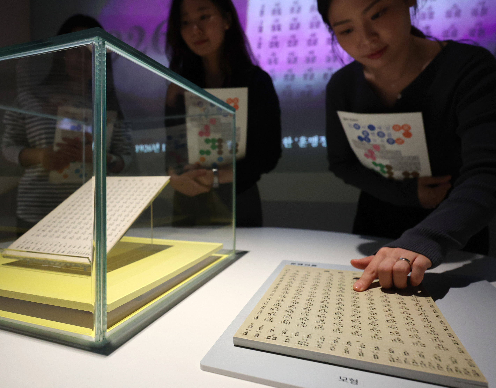

## 2. NISI20261006_0021477831

진열장 속 한글·점자 대조 자료와 관람객

원본: 2548 × 1857 px. [다운로드/원본 보기](originals/NISI20261006_0021477831.jpg)

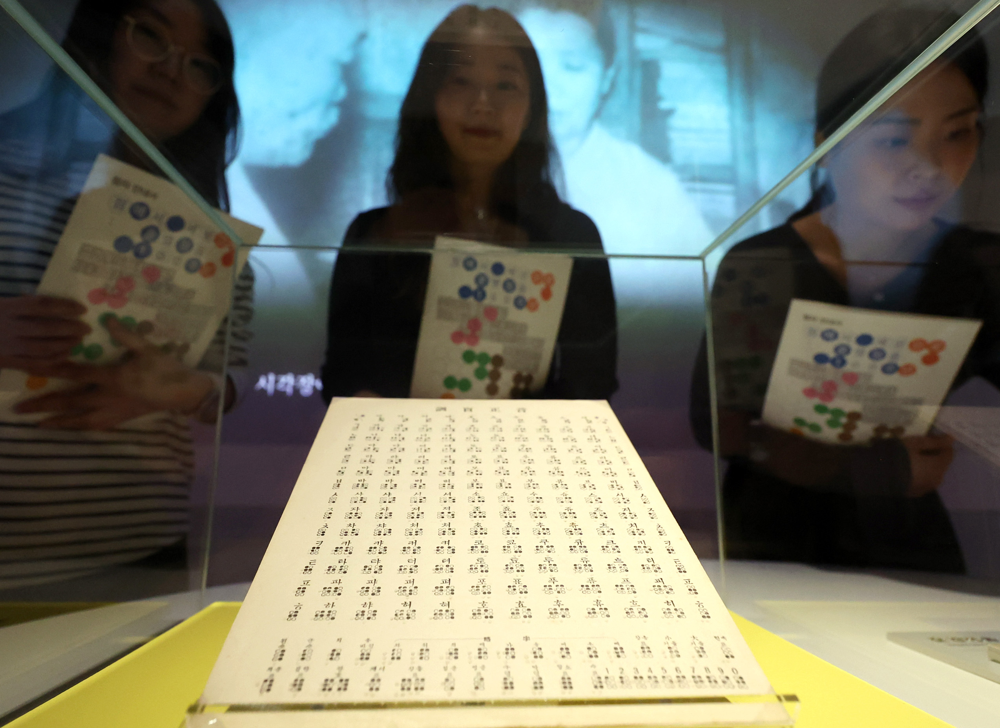

## 3. NISI20261007_0021480077

어린이들과 성인이 촉각 전시물을 살펴보는 장면

원본: 5549 × 3625 px. [다운로드/원본 보기](originals/NISI20261007_0021480077.jpg)

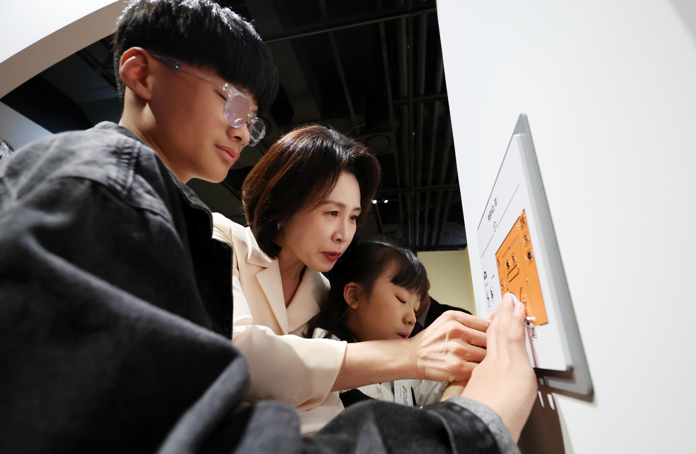

## 4. NISI20261006_0021477826

박두성의 한글 점자 관련 문서 전시

원본: 3006 × 2247 px. [다운로드/원본 보기](originals/NISI20261006_0021477826.jpg)

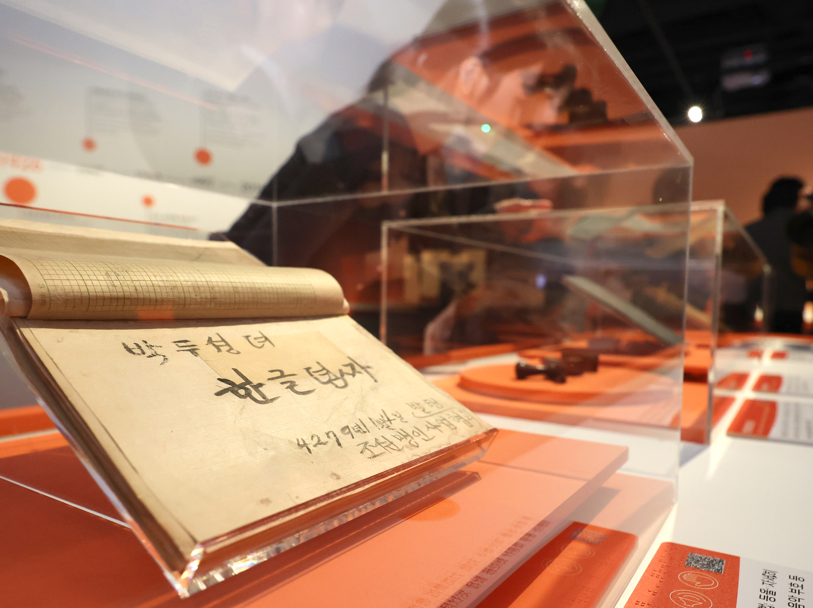

## 5. NISI20261027_0002274891

점자 도서와 독서 보조기기가 있는 열람 공간

원본: 5712 × 4284 px. [다운로드/원본 보기](originals/NISI20261027_0002274891.jpg)

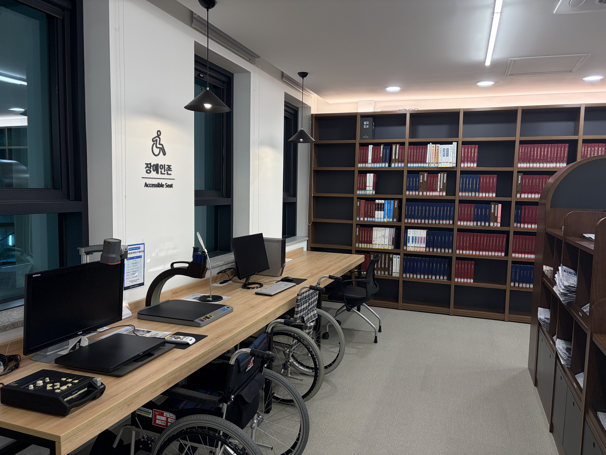

## 6. NISI20261008_0002259232

훈맹정음 점자표 설명 패널

원본: 6000 × 4000 px. [다운로드/원본 보기](originals/NISI20261008_0002259232.jpg)

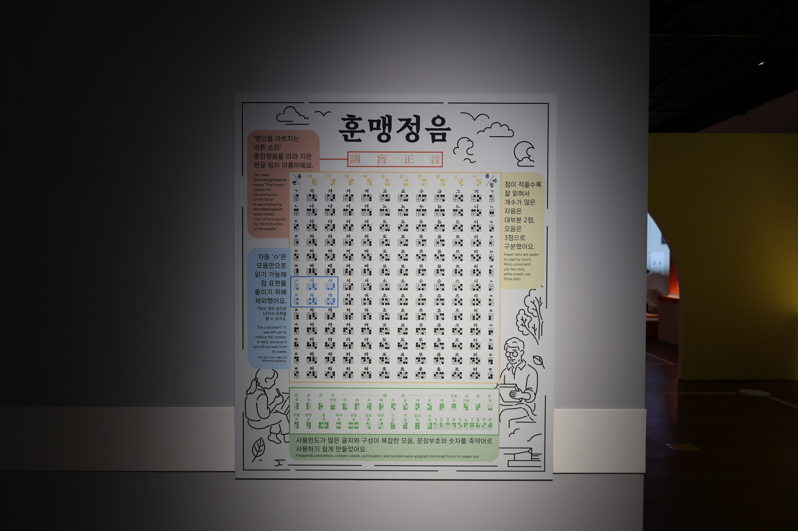

## 7. NISI20261008_0002259230

훈맹정음 자료와 체험용 판이 놓인 전시장

원본: 6000 × 4000 px. [다운로드/원본 보기](originals/NISI20261008_0002259230.jpg)

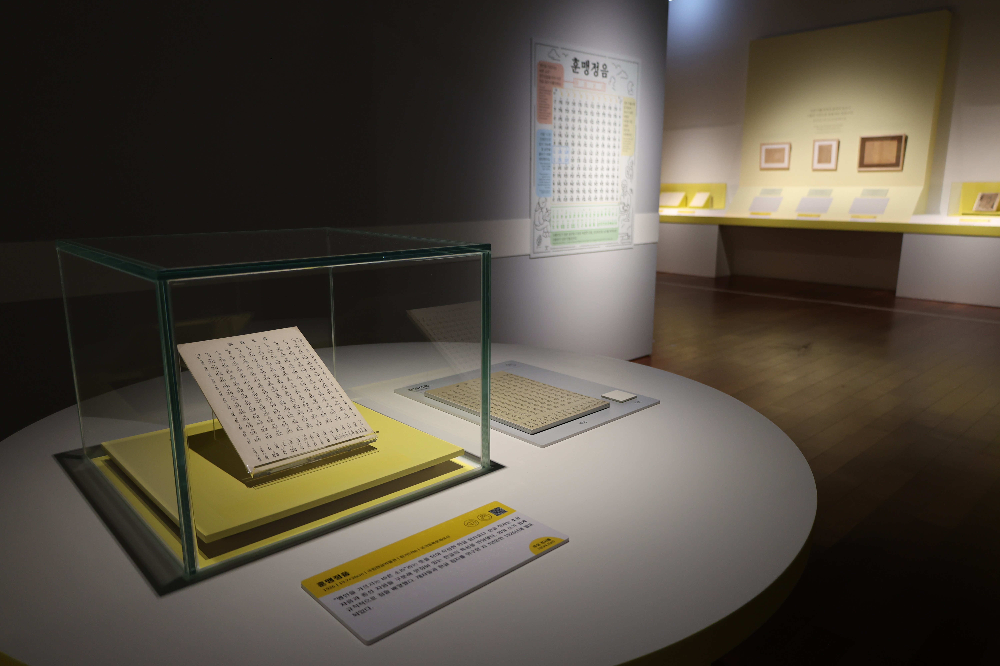

## 8. NISI20261008_0002259224

세계 점자 지도 체험 전시

원본: 6000 × 4000 px. [다운로드/원본 보기](originals/NISI20261008_0002259224.jpg)

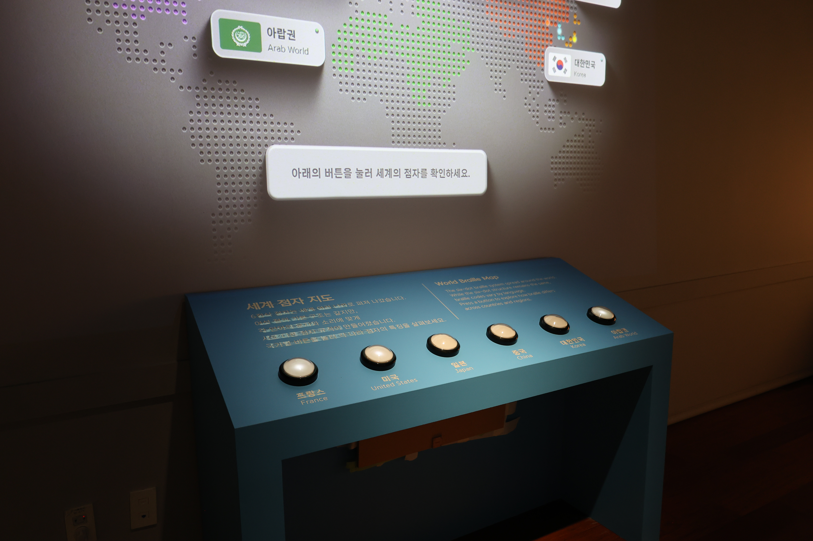

## 9. NISI20261008_0002259237

점자 쓰기 체험 공간

원본: 6000 × 4000 px. [다운로드/원본 보기](originals/NISI20261008_0002259237.jpg)

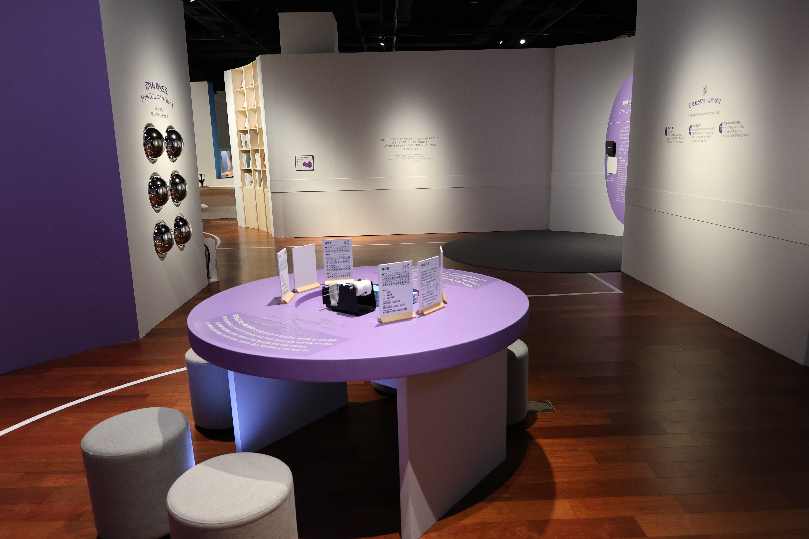

## 10. NISI20261008_0002259227

돌출 문자 관련 옛 책 전시

원본: 6000 × 4000 px. [다운로드/원본 보기](originals/NISI20261008_0002259227.jpg)

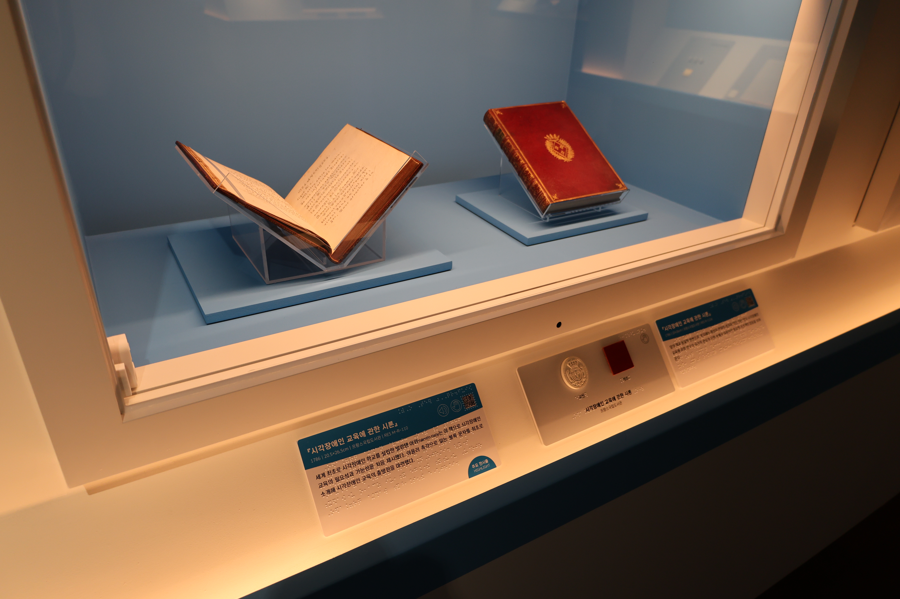

## 11. NISI20250519_0020815195

점자 선거 안내물을 손으로 짚는 근접 장면

원본: 2431 × 2604 px. [다운로드/원본 보기](originals/NISI20250519_0020815195.jpg)

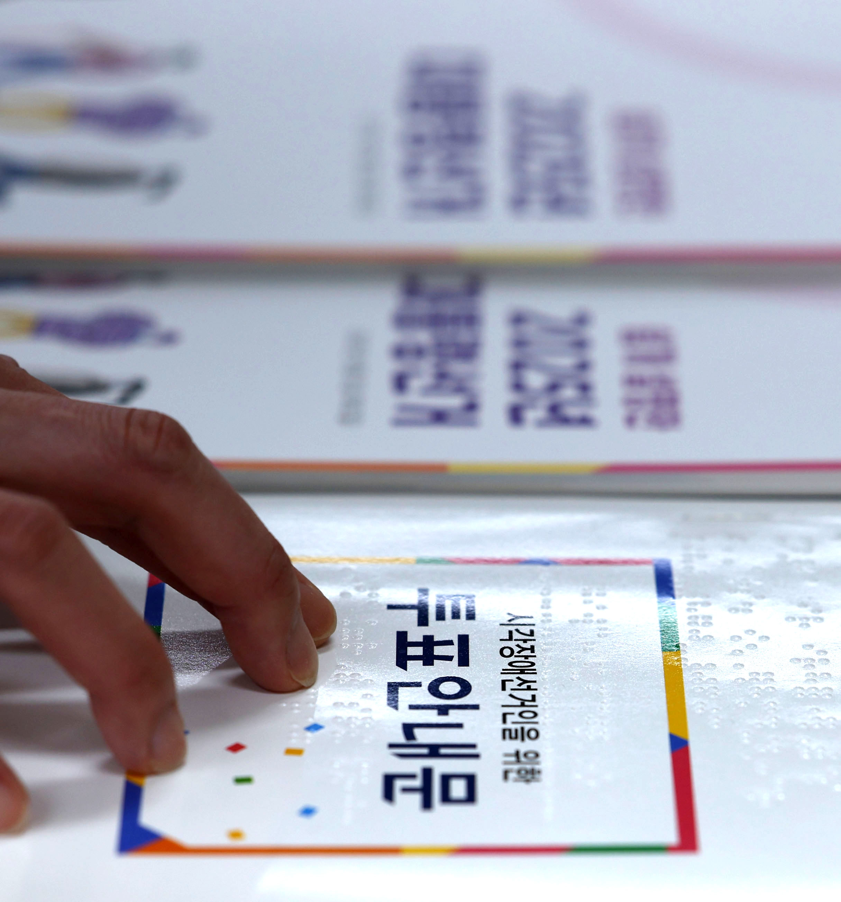

## 12. NISI20251103_0021042483

펼친 점자책과 두 손

원본: 3129 × 1980 px. [다운로드/원본 보기](originals/NISI20251103_0021042483.jpg)

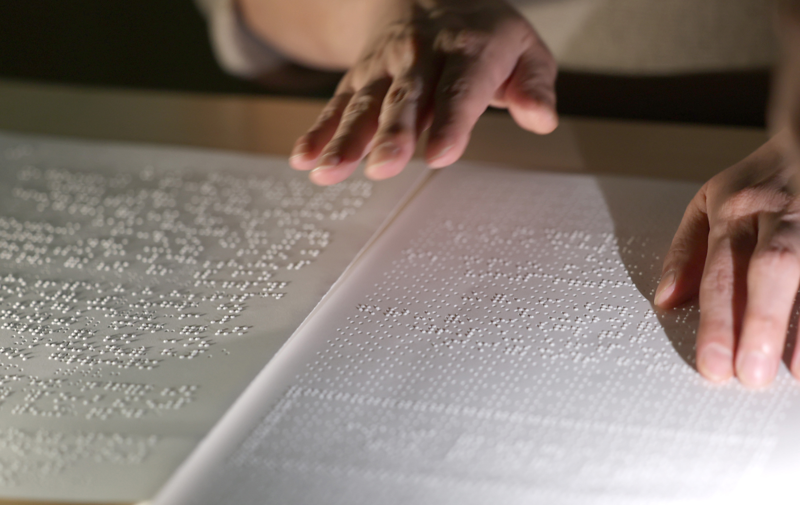

## 13. NISI20251103_0021042482

점자책 위 두 손의 근접 장면

원본: 3075 × 1830 px. [다운로드/원본 보기](originals/NISI20251103_0021042482.jpg)

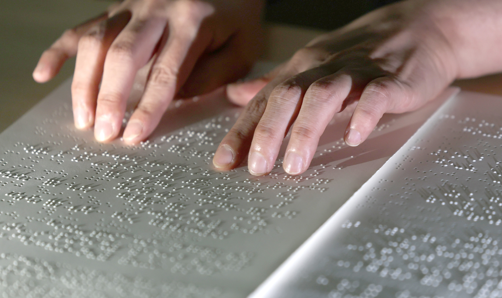

## 14. NISI20251103_0001982462

일반 글자와 점자 표기가 함께 인쇄된 해설서

원본: 4000 × 3000 px. [다운로드/원본 보기](originals/NISI20251103_0001982462.jpg)

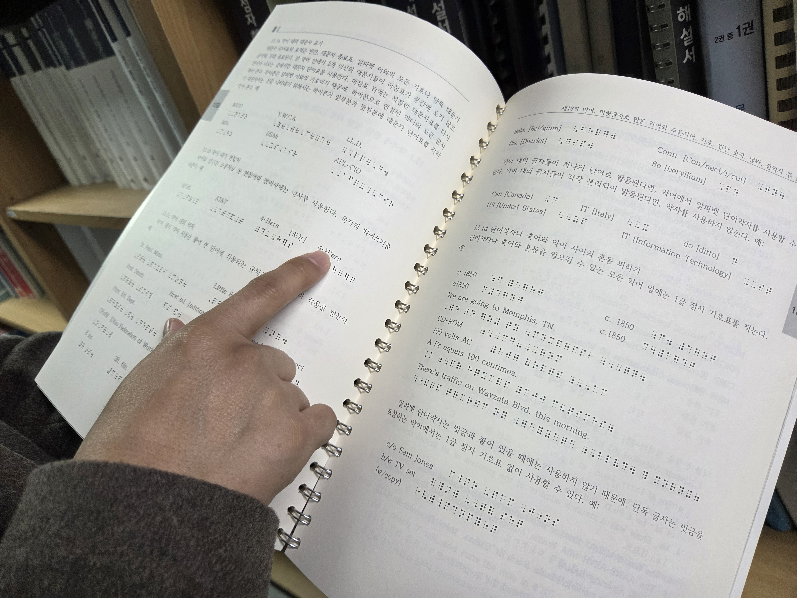

## 15. NISI20251103_0021042526

손끝과 점자 돌기·그림자의 근접 장면

원본: 4920 × 3484 px. [다운로드/원본 보기](originals/NISI20251103_0021042526.jpg)

